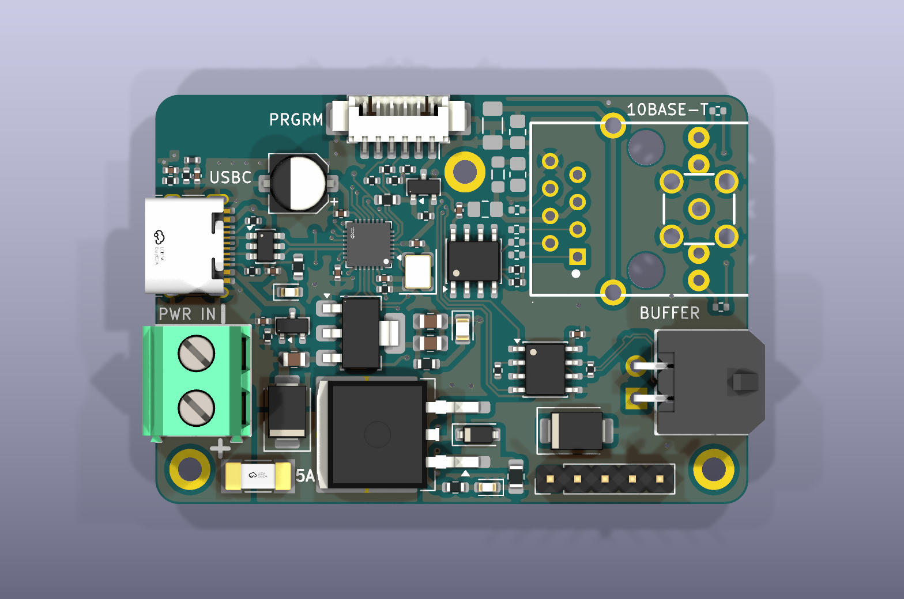

# OpenAMS

Run Bambu Lab AMS units, and other multi-material units, from a Klipper
printer: automatic filament changes from your slicer's `T0`, `T1`, ... tools,
runout reload from a spare spool, spool tracking with Spoolman, and a panel in
Mainsail.



## Pick your hardware

| You have | It connects through | Start here |
|---|---|---|
| A stock **AMS 1, AMS 2 Pro or AMS HT** | A **Cortex Bridge** board on USB, with Bambu Lab's standard filament buffer instead of an OpenAMS FPS. The AMS keeps its Bambu Lab firmware; nothing is opened or flashed. | [Set up a Cortex Bridge printer](docs/guide/cortex-bridge-setup.md) |
| An AMS fitted with **OpenAMS boards** (OpenAMS mainboard and FPS) | CAN, usually | [Install](docs/guide/install.md), then [Configure](docs/guide/configure.md) |
| A **BoxTurtle, ERCF, NightOwl** or similar MMU | klipper-mmu on the MMU's own microcontroller | [klipper-mmu](klipper_mmu/README.md) |

## Install

On the Klipper computer, as the user that runs Klipper:

```bash
git clone https://github.com/OpenAMSOrg/openams.git ~/openams
cd ~/openams
./install.sh
```

Do not use `sudo`; the installer asks for your password when it needs it. It
links OpenAMS into Klipper and Moonraker, sets up Spoolman, adds OpenAMS to
Mainsail's Update Manager and adds `[include oams.cfg]` to `printer.cfg`. With
a Cortex Bridge connected it also installs the bridge relay and writes your
AMS units into `oams.cfg`. It never overwrites a config file you have, and it
is safe to run again.

Flags, what each step changes, and how to uninstall:
[install guide](docs/guide/install.md).

## Check that it works

With a Cortex Bridge:

```bash
python3 ~/openams/tools/cortex-bridge.py status
```

It checks USB, the relay and each AMS, and its last line names the next
thing to do. For any printer, the read-only bring-up check tests everything
from the config to the units:

```bash
python3 ~/openams/tools/agent/bringup_check.py --selftest
```

## Use it

Slice with one tool per filament group: `T0` loads the bay assigned to group
`T0`, and so on. Loads and unloads from Mainsail's console:

```gcode
OAMSM_LOAD_TO_TOOLHEAD GROUP=T0
OAMSM_UNLOAD_FROM_TOOLHEAD
```

[Using OpenAMS](docs/guide/using.md) covers toolchanges, runout, groups and
calibration.

## Update

Mainsail: **Machine → Update Manager**, entry `openams`, then run
`./install.sh` again to link any new files. On a Cortex Bridge printer the
update restarts the bridge relay and may bring new bridge firmware, which you
install separately: [update the Cortex Bridge firmware](docs/guide/cortex-bridge-update.md).

## Screens and front ends

- **Mainsail and Fluidd:** the OpenAMS panel from
  [mmu-display](https://github.com/OpenAMSOrg/mmu-display) shows each unit,
  its bays and spools, and drives loads, groups and drying.
- **HelixScreen** supports OpenAMS natively from v1.1.0-beta.1.
- **Your own UI:** the versioned [OpenAMS UI API](docs/UI_API.md), including
  the Cortex Bridge status and firmware update calls.

## Documentation

| Read | When |
|---|---|
| [The guide](docs/guide/README.md) | Setting up, configuring and running a printer. Start here. |
| [Set up a Cortex Bridge printer](docs/guide/cortex-bridge-setup.md) | You have a Cortex Bridge: wiring to first load, step by step. |
| [The Cortex Bridge board](docs/guide/cortex-bridge-hardware.md) | Connectors, pinouts and LEDs of the bridge. |
| [Troubleshooting](docs/guide/troubleshooting.md) | An error message, matched to its cause. |
| [Configuration reference](docs/guide/reference.md) | Every option and command. |
| [install.agents.md](install.agents.md) | You are installing with an AI agent. |
| [docs/README.md](docs/README.md) | Contracts, testing, the UI API and klipper-mmu internals. |

## Getting help

Run the checks above first; they name most problems. On a Cortex Bridge
printer, `python3 ~/openams/tools/cortex-bridge.py support` writes a report
you can attach to a request. Ask for help on
[Discord](https://discord.gg/Ab8TrGarpu).

## For developers

| Folder | What it is |
|---|---|
| [`src/`](src/) | The Klipper extras: the units, the manager, the FPS lanes and the UI status |
| [`moonraker/`](moonraker/) | Moonraker components: `openams_spoolman` and `openams_bridge` |
| [`cortex_bridge/`](cortex_bridge/) | The Cortex Bridge relay, its setup tools and the bundled bridge firmware |
| [`klipper_mmu/`](klipper_mmu/) | The klipper-mmu MCU add-on (GPL) |
| [`klipper_patches/`](klipper_patches/) | Optional Klipper CAN patches (GPL) |
| [`tools/`](tools/) | Customer and agent tools: `cortex-bridge.py`, `agent/` checks |
| [`test/`](test/) | The test suite: `python3 -m unittest discover -s test` (or `make test`) |

[ARCHITECTURE.md](ARCHITECTURE.md) explains how the parts fit together.

## Credits

This project was made by knight.rad_iant on Discord.

## License

This repository ships three components under two licenses:

| What | License | Where |
|---|---|---|
| Everything outside `klipper_mmu/` and `klipper_patches/`: the Klipper host plugin (`src/`), the Moonraker components (`moonraker/`), the Cortex Bridge relay and tools (`cortex_bridge/`), the tests and the documents under `docs/` | **MIT** | [`LICENSE`](LICENSE) |
| `klipper_mmu/` — the Klipper MCU add-on package and everything under it | **GPL-3.0-or-later** | [`klipper_mmu/COPYING`](klipper_mmu/COPYING), [`klipper_mmu/NOTICE.md`](klipper_mmu/NOTICE.md) |
| `klipper_patches/` — the optional patch series to Klipper and everything under it | **GPL-3.0** (patches to Klipper, which is GPL-3.0) | [`klipper_patches/COPYING`](klipper_patches/COPYING), [`klipper_patches/NOTICE.md`](klipper_patches/NOTICE.md) |

The two are separate works that are distributed together. `klipper_mmu/` is
GPL-3.0-or-later because it is a Klipper MCU add-on and links against GPL
Klipper code; that obligation does not extend to the MIT-licensed host plugin
outside it. `klipper_patches/` is GPL for the same reason: its patches are
changes to Klipper. The installer helper that applies them,
`tools/klipper_patches.py`, contains no Klipper code and stays MIT.
`klipper_mmu/NOTICE.md` records the source and licensing boundary for the
package, including the upstream code it adapts.

The signed, encrypted packages in `cortex_bridge/firmware/` are the Cortex
Bridge's own firmware, distributed in that form only; they are not covered by
the MIT license.
