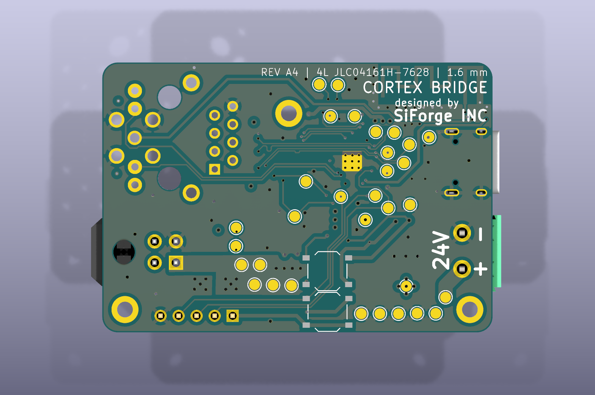
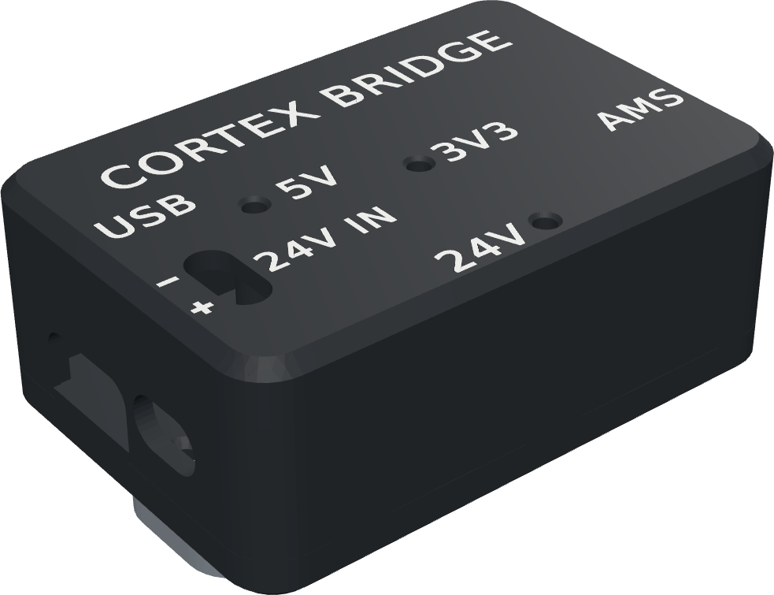
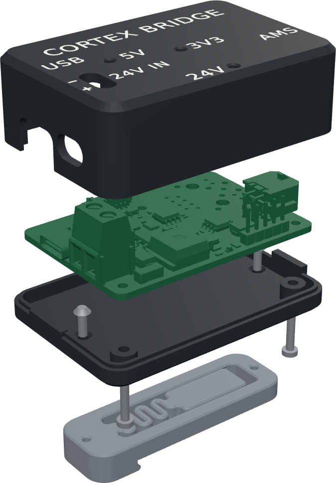

# The Cortex Bridge board

## What it is, and why it exists

A stock Bambu Lab AMS talks to its printer over a 24 V RS-485 bus, through the
filament buffer. The Cortex Bridge takes the printer's place on that bus. It
connects to your Klipper computer by USB on one side, and to the AMS buffer on
the other, so an unmodified AMS1, AMS 2 Pro or AMS HT runs from Klipper.

Nothing on the AMS is opened, replaced or flashed. The AMS keeps its Bambu Lab
firmware and keeps running its own motors, sensors, RFID and dryer. The bridge
tells it what to do, and OpenAMS on the Klipper computer tells the bridge.

```text
Klipper computer ── USB-C ── Cortex Bridge ── 4-pin ── AMS buffer ── 6-pin ── AMS ── 6-pin ── next AMS
                                  │
                 printer's 24 V power supply (PWR IN)
```


This page tours the board. [Set up a Cortex Bridge printer](cortex-bridge-setup.md)
is the step-by-step installation.

## The board


Component side. USB-C (J1) is on the left edge, with the green PWR IN terminal
(P1) below it. The BUFFER connector (CN1) is on the right edge. The small white
PRGRM connector (J4) at the top and the 5-pin header (J7) at the bottom right
are not used during installation.



Underside. The **REV A4** marking identifies the board revision, and the
**24V − +** marking sits next to the power terminal.

Both pictures are renders of the standard assembly, not photographs. The
**10BASE-T** outline on the top silkscreen is an Ethernet option that is not
fitted; its pads are empty on a standard board.

## Connectors

| Ref | Label | Type | Connect it to | Needed? |
|---|---|---|---|---|
| J1 | USBC | USB-C, USB 2.0 device | A USB port on the Klipper computer, with a **data** cable | Yes |
| P1 | PWR IN | 2-way 5.08 mm screw terminal | Spare +24 V and 0 V terminals on the printer's 24 V power supply | Yes |
| CN1 | BUFFER | 4-pin, 3.0 mm pitch, 2×2 (Micro-Fit 3.0 style) | The 4-pin connector on the original AMS filament buffer | Yes |
| J4 | PRGRM | 6-pin Molex PicoBlade, 1.25 mm | Nothing; factory use only | No |
| J7 | — | 5-pin 2.54 mm header | Nothing; factory debug only | No |

### PWR IN (P1)

| Pin | Signal |
|---|---|
| 1 (+) | +24 V in |
| 2 (−) | 0 V / ground |

The + and − are marked on both sides of the board. The board blocks a reversed
supply from reaching the AMS, but nothing works until it is the right way
round, so check before switching on.

### BUFFER (CN1)

| Pin | Signal |
|---|---|
| 1 | +24 V out to the AMS |
| 2 | 0 V / ground |
| 3 | RS-485 P |
| 4 | RS-485 N |

These are connector pin numbers, not a left-to-right order in a picture. Use
Bambu Lab's 4-pin buffer cable as it is; do not re-pin a cable to match this table. The
connector carries 24 V, so plug and unplug it only with the power off.

## Power

The bridge has two power inputs, and it needs both.

- **USB powers the bridge itself.** Its microcontroller runs from the USB 5 V,
  through a 3.3 V regulator. With USB unplugged the bridge is off, even with
  24 V connected.
- **24 V powers the AMS.** It enters at PWR IN, goes through a 5 A fuse and a
  reverse-polarity stage, and leaves on BUFFER pin 1 for the buffer and the
  AMS units behind it. Surge suppressors on the input and the output clamp
  spikes from long cables and hot-plugging.

Take the 24 V from the printer's own 24 V power supply, on spare terminals.
That supply must have spare capacity for the AMS units: an AMS that is drying
draws far more than one that is idle, so check it against drying, not idle.
If it has no capacity to spare, a separate 24 V DC supply works the same way.
The board fuse is 5 A.

## Status LEDs

| LED | Colour | On means | If it stays off |
|---|---|---|---|
| D9 | White | USB 5 V is present | Check the USB cable and port. Some USB-C cables are charge-only. |
| D10 | Green | The bridge's 3.3 V is running | It needs the white LED. If white is on and green is off, contact support. |
| D8 | Red | 24 V is on the BUFFER output | Check the wires from the printer's 24 V supply, their polarity at PWR IN, and the fuse. |

With USB and 24 V connected, all three are on. The LEDs show power only; they
do not show traffic or errors. Use the [status check](cortex-bridge-setup.md#6-check-the-bridge)
for that.

## How it appears on the Klipper computer

Plugged into USB, the bridge appears as a USB serial device:

```text
$ lsusb | grep 1a86:fe11
Bus 001 Device 012: ID 1a86:fe11 QinHeng Electronics Cortex Bridge
$ ls /dev/serial/by-id/ | grep Cortex
usb-OpenAMS_Cortex_Bridge_CB0123456789AB-if00
```

`CB` plus 12 hex digits is the board's serial number. It is unique per board
and never changes.

You never put that device in `printer.cfg`. The bridge relay that OpenAMS
installs owns it, and gives Klipper one port per AMS instead:

```text
$ ls -l /dev/oams/
lrwxrwxrwx 1 pi dialout 10 Oct  8 23:57 0a1b2c3d4e5f -> /dev/pts/2
lrwxrwxrwx 1 pi dialout 10 Oct  8 23:57 5f4e3d2c1b0a -> /dev/pts/5
```

Each name is that AMS unit's ID. It stays the same across restarts and does not
depend on which USB port or bus position you use.

## The case

The bridge lives in a two-part printed case that leaves the USB-C, PWR IN and
BUFFER connectors open, shows the three LEDs through light guides in the lid,
and gives the PWR IN screws a slot for a screwdriver. It mounts on the
printer's rear panel with double-sided foam tape, or on a DIN rail with the
optional clip, for example under the printer. If Bambu Lab's short 4-pin cable
from the buffer does not reach that far, add a
BIQU 4-pin 1 m extension ([BIQU](https://biqu.equipment/products/biqu-ams-upgrades-multi-material?variant=41897374351458),
[Amazon](https://www.amazon.com/clp/B0F93RMF2X)) between it and the bridge. The files are in [`hardware/cortex-bridge-case/`](../../hardware/cortex-bridge-case/).





| Part | File | Qty | Notes |
|---|---|---|---|
| Base | `bridge_case_base_standard.stl` | 1 | Prints as oriented, no supports |
| Lid | `bridge_case_lid_standard.stl` | 1 | Prints roof-down, no supports |
| Lid with two-colour lettering | `bridge_case_lid_standard_2colour.3mf` | (1) | Instead of the plain lid, on a printer with two filaments: assign the lettering a contrasting colour |
| DIN rail clip (TS35) | `din_clip.stl` | (1) | Optional, instead of the tape |
| Case screws | M2 × 10 socket head cap screw, hex socket (ISO 4762 / DIN 912) | 3 | From below, through the base and the board into the lid. They sit flush in the base's 4.4 mm counterbores. M2 × 10 button heads (ISO 7380) also fit |
| Light guides | 1.75 mm clear (natural) filament, about 20 mm | 3 | One per LED |
| Double-sided foam tape | outdoor or VHB-type mounting tape | 1–2 strips | On the base, for the printer's rear panel |
| DIN clip screws | M2 × 6 countersunk screw, hex socket (ISO 10642 / DIN 7991) | (2) | Only with the DIN clip: from inside the base into the clip |

Print in PETG, ASA or ABS. PLA softens behind an enclosed or heated printer.

To assemble:

1. If you use the DIN clip, screw it to the outside of the base first, with
   the two M2 × 6 countersunk screws from inside the base.
2. Lay the board in the base, its three mounting holes on the base's
   standoffs, with USB-C and PWR IN on the same side as the base's openings.
3. Put the lid on. Its notches go over the USB-C, BUFFER and PRGRM connectors.
4. Turn the case over and drive the three M2 × 10 screws from below, through
   the base and the board, into the lid. Snug, not tight: the lid is plastic.
5. Push a piece of clear filament into each of the three LED holes in the lid
   until it stops on the LED, and cut it flush with the roof.
6. Stick the foam tape on the base (not on the DIN clip), clean the printer's
   rear panel, and press the case on for a few seconds.

## Not used during installation

- **PRGRM (J4).** A factory connector. Leave it unconnected.
- **J7.** The bridge's factory debug header. Leave it unconnected.
- **Button pads SW1 and SW2** on the underside. Not fitted. Unplugging USB
  restarts the bridge.
- **Antenna.** The printed antenna along the top edge is for Bluetooth, which
  the AMS connection does not use.
- **10BASE-T, and the RF test connector footprint.** Options that are not
  fitted on a standard board.

## Where to go next

- [Set up a Cortex Bridge printer](cortex-bridge-setup.md) — wiring, install,
  configuration and the first load.
- [Update the Cortex Bridge firmware](cortex-bridge-update.md) — signed
  firmware releases for the bridge.
