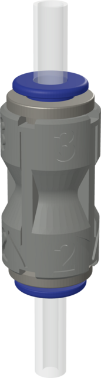
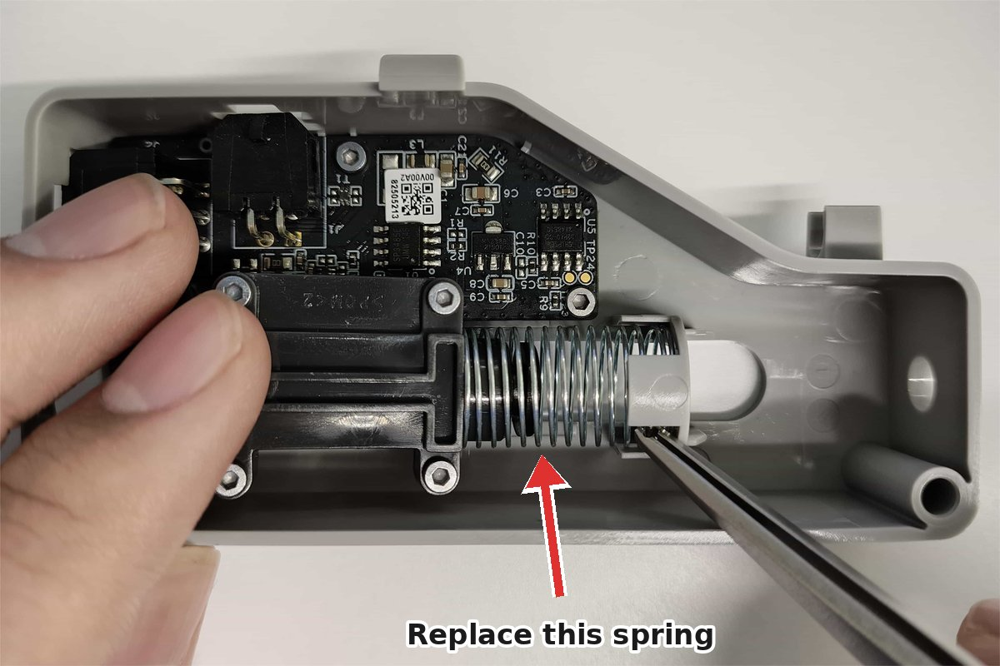
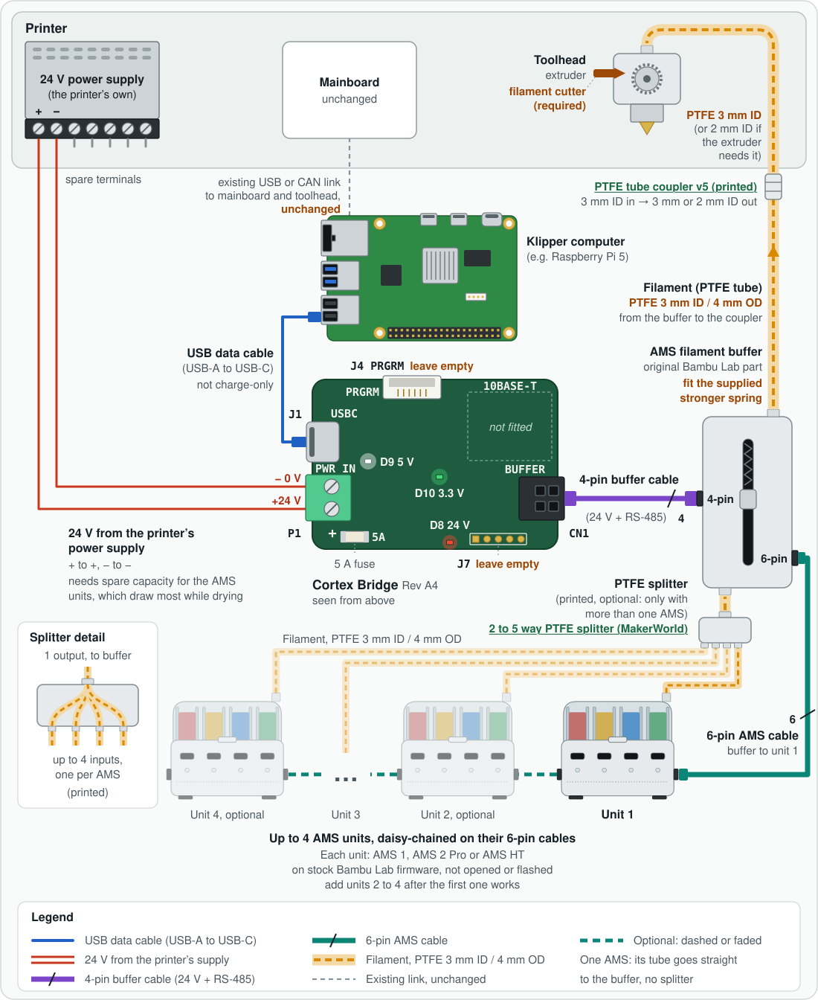

# Set up a Cortex Bridge printer

## What this page does

It takes you from a Cortex Bridge board in its bag to a Klipper printer that
loads filament from a stock Bambu Lab AMS. Follow the sections in order. Each
one ends with a check, so you know it worked before you move on.

Nothing on the AMS is opened or flashed. It keeps its Bambu Lab firmware.

| Step | What you do | Time |
|---|---|---|
| [1. Gather the parts](#1-gather-the-parts) | Check you have everything | 5 min |
| [2. Prepare the printer](#2-prepare-the-printer) | Back up, update, fit the buffer spring, lay the tube | 20 min |
| [3. Wire the bridge](#3-wire-the-bridge) | Case, USB, 24 V, buffer and AMS cables | 20 min |
| [4. Power on](#4-power-on) | Read the three LEDs | 1 min |
| [5. Install OpenAMS](#5-install-openams) | One command; it also writes your AMS config | 5 min |
| [6. Check the bridge](#6-check-the-bridge) | See your AMS on the Klipper computer | 1 min |
| [7. Finish the config](#7-finish-the-config) | Path length, cutter, toolhead macros | 15 min |
| [8. Add the Mainsail panel](#8-add-the-mainsail-panel) | See and drive the AMS from Mainsail | 2 min |
| [9. First load](#9-first-load) | Load, unload and swap once, watching | 15 min |

Later: [keep it up to date](#keep-it-up-to-date) and, when something is
wrong, [troubleshooting](#troubleshooting).

## 1. Gather the parts

- A **Cortex Bridge** board, Rev A4. The revision is printed on the underside.
- A **USB data cable** from the bridge's USB-C port to your Klipper computer.
  A charge-only cable powers the bridge but it never appears in `lsusb`.
- **24 V from the printer's power supply:** two wires from spare **+24 V** and
  **0 V** terminals on the printer's 24 V supply to the bridge's screw
  terminal, rated for at least 5 A (0.75 mm², 18 AWG, or thicker). The supply must have spare capacity for the AMS units, which draw
  the most while drying. A separate 24 V supply also works.
- The **stronger buffer spring** that comes with the Cortex Bridge. It replaces
  the spring in the Bambu Lab buffer (step 2).
- The **case**: printed base and lid, three **M2 × 10** screws, and
  **double-sided foam tape** to stick it to the printer's rear panel. A DIN
  rail clip is optional. [The case](cortex-bridge-hardware.md#the-case) lists
  the parts.
- An original Bambu Lab **AMS filament buffer** with its **4-pin buffer
  cable**, which runs from the bridge's BUFFER connector to the buffer. Both
  come with the AMS1; for an AMS 2 Pro, Bambu Lab sells the filament buffer
  with its cable as an addition.
- Optional: a **BIQU AMS Lite cable extension, 4-pin, 1 m**
  ([BIQU](https://biqu.equipment/products/biqu-ams-upgrades-multi-material?variant=41897374351458),
  [Amazon](https://www.amazon.com/clp/B0F93RMF2X)), if
  Bambu Lab's short 4-pin cable does not reach. It plugs in between that cable
  and the bridge, so the bridge can sit further from the buffer, for example
  on its DIN clip under the printer, with a single 4-pin run. A 0.5 m version
  is also sold.
- The stock **6-pin cable** from the AMS to the buffer.
- One **AMS1, AMS 2 Pro or AMS HT**, still running its Bambu Lab firmware.
- A Klipper printer that already prints, with **Moonraker** and **Mainsail**,
  and SSH access to its computer (a Raspberry Pi or similar Linux computer).
- A **filament cutter** at the toolhead. OpenAMS cuts the filament before every
  swap; tip forming is not supported.
- **PTFE tube, 3 mm inside and 4 mm outside diameter (3 mm ID / 4 mm OD)**, for
  the filament path: AMS to buffer, and buffer to the coupler below, and
  normally on to the toolhead. This size is critical. Narrower tube, such as
  the common 2 mm ID tube, adds so much friction that the AMS cannot push
  filament to the toolhead reliably. The one exception is the last tube, from
  the coupler into the toolhead, when your extruder only takes 2 mm ID tube.
- A printed **PTFE tube coupler v5**
  ([`hardware/ptfe-coupler/ptfe_coupler_v5.stl`](../../hardware/ptfe-coupler/ptfe_coupler_v5.stl))
  with two **ECAS04 push-fit collets**, joining the buffer's outlet tube to the
  tube that runs to the toolhead. Its **3** end takes the 3 mm ID tube from the
  buffer. Its **2** end takes either 3 mm ID or 2 mm ID tube to the toolhead,
  and tapers smoothly between the two sizes. The arrows on its body point the
  way the filament travels.

  
- Only with more than one AMS: a printed **PTFE splitter**
  ([2 to 5 way PTFE splitter, MakerWorld](https://makerworld.com/en/models/816201-2-to-5-way-ptfe-splitter#profileId-2452271))
  that merges the AMS units' filament tubes into one before the buffer.

Start with one AMS. Add more after the first one loads and unloads cleanly; the
bridge takes up to four, daisy-chained.

## 2. Prepare the printer

1. Print something small and check the printer works **without** the AMS. Any
   problem you have now will still be there with the AMS attached.
2. In Mainsail, open **Machine** and download a backup of your configuration
   folder. You can restore it if anything goes wrong.
3. Update Klipper and Moonraker from Mainsail's **Machine → Update Manager**.
4. **Fit the stronger buffer spring.** Open the Bambu Lab filament buffer the
   way Bambu Lab's
   [buffer slider and spring steps](https://wiki.bambulab.com/en/ams/filament-buffer-connection-board-replacement-guide#step-1-remove-the-buffer-slider-and-spring)
   show, take out its spring,
   put in the stronger spring that came with the Cortex Bridge, and close the
   buffer again. The stronger spring lets the buffer push back against the
   longer PTFE tube of a Klipper printer without reporting the filament as
   arrived too early. Check that the slider moves freely and springs back.

   

   *Photo: [Bambu Lab Wiki](https://wiki.bambulab.com/ams/filament-buffer-connection-board/slide-spring-install.jpg), arrow added.*
5. Lay the PTFE tube from the buffer to the toolhead with gentle bends, joined
   just before the printer with the printed PTFE tube coupler v5. Push the
   tube from the buffer into the coupler's **3** end and the tube to the
   toolhead into its **2** end.
   - Use **3 mm ID / 4 mm OD** tube everywhere up to the coupler, and from the
     coupler to the toolhead too if your extruder takes it.
   - If your extruder's entrance only takes 2 mm ID tube (the Orbiter, for
     example), use 2 mm ID tube from the coupler to the toolhead. Do not join
     3 mm and 2 mm tube any other way: where 3 mm tube meets 2 mm tube
     directly, the 1 mm step catches the filament tip. The coupler's taper
     guides the filament past it.

   The filament must slide through the whole path by hand without catching.

**Check:** the printer prints, you have a configuration backup, and the
buffer has the stronger spring.

## 3. Wire the bridge

Do all the wiring with the printer **switched off at the mains** and the
bridge's USB unplugged.

First put the board in its case and mount it: three M2 × 10 screws from below
through the base and the board into the lid, then double-sided foam tape on
the base to stick the case to the printer's rear panel, within reach of the
printer's 24 V supply and of the buffer cable. The optional DIN clip mounts it
on a rail instead, for example under the printer, with the BIQU 4-pin extension
if the buffer's cable does not reach. [The case](cortex-bridge-hardware.md#the-case) has the
parts and the order.



```text
Klipper computer ── USB-C ── Cortex Bridge ── 4-pin ── AMS buffer ── 6-pin ── AMS ── 6-pin ── next AMS
                                  │
                 printer's 24 V power supply (PWR IN)
```

1. **24 V to PWR IN.** Run two wires from spare terminals on the printer's
   24 V power supply: **+24 V** (often marked `V+`) and **0 V** (often `V−` or
   `COM`). Loosen the two screws on the bridge's green terminal, put the
   **+24 V** wire in the terminal marked **+** and the **0 V** wire in the one
   marked **−**, then tighten both and tug each wire. If you are not sure which
   supply terminals are spare, check the supply's label or the printer's
   wiring diagram before connecting anything.
2. **BUFFER to the buffer.** Plug the 4-pin cable into the bridge's BUFFER
   connector until the latch clicks. Plug its other end into the 4-pin
   connector on the AMS buffer. If the bridge sits further away, put the
   BIQU 4-pin 1 m extension ([BIQU](https://biqu.equipment/products/biqu-ams-upgrades-multi-material?variant=41897374351458),
   [Amazon](https://www.amazon.com/clp/B0F93RMF2X)) between Bambu Lab's cable and the bridge.
3. **AMS to the buffer.** Plug the AMS's stock 6-pin cable into the AMS and into
   the buffer, the same way it connects on a Bambu Lab printer. More AMS
   units are daisy-chained: each one's 6-pin cable goes to the free 6-pin
   port on the AMS before it, never back to the buffer.
4. **USB.** Connect the bridge's USB-C port to a USB port on the Klipper
   computer. Use a port on the computer itself, not a hub with its own power
   switch.
5. Leave the small **PRGRM** connector and the **5-pin header** empty.

See [The Cortex Bridge board](cortex-bridge-hardware.md) for pinouts and
pictures.

**Check:** every plug is fully seated, and the + wire is in the + terminal.

## 4. Power on

Switch the printer on. USB is already connected. Three LEDs light:

| LED | Colour | Means |
|---|---|---|
| D9 | White | USB power |
| D10 | Green | The bridge is running |
| D8 | Red | 24 V reaches the buffer and the AMS |

The AMS starts up as it does on a Bambu Lab printer.

**Check:** all three LEDs are on. If one is not, see
[Status LEDs](cortex-bridge-hardware.md#status-leds) and fix it before going on.

## 5. Install OpenAMS

Log in to the Klipper computer over SSH as the user that runs Klipper (on most
printers, `pi`). Keep the bridge and the AMS powered, then run:

```bash
git clone https://github.com/OpenAMSOrg/openams.git ~/openams
cd ~/openams
./install.sh
```

Do not put `sudo` in front of `./install.sh`; it asks for your password itself
when it needs it.

The installer sees the bridge on USB and does everything for it:

- installs the bridge relay, the `cortex-bridge` service that gives Klipper
  one serial port per AMS;
- adds you to the `dialout` group and sets up `/dev/oams`;
- writes `oams.cfg` from the Cortex Bridge sample and adds your AMS units to
  it, after asking each one what it is;
- adds OpenAMS to Mainsail's Update Manager.

The end of its output looks like this:

```text
Installing the Cortex Bridge relay...
  relay Python: /home/pi/klippy-env/bin/python
...
Cortex Bridge relay installed [OK]
...
Looking for AMS units behind the bridge (up to 45 s)...
  0a1b2c3d4e5f  AMS 2 Pro, 4 bays
Added ams2 to /home/pi/printer_data/config/oams.cfg.
Next: measure each AMS's filament path and set ptfe_length (`cortex-bridge.py ptfe <millimetres>`).
...
Starting Klipper... [OK]
```

**Check:** you see `Cortex Bridge relay installed [OK]` and one line per AMS.

- `No Cortex Bridge connected; skipping its relay` means the computer cannot
  see the bridge. Check the USB cable and the white LED, then run
  `./install.sh` again. It is safe to run as often as you like.
- `No AMS was added to oams.cfg yet` means the bridge is fine but no AMS
  answered. Check the red LED, the BUFFER cable and the AMS cable, then run
  `python3 ~/openams/tools/cortex-bridge.py config --write`.

## 6. Check the bridge

One command shows what is connected and the next thing to do:

```bash
python3 ~/openams/tools/cortex-bridge.py status
```

```text
Cortex Bridge
  USB:         running, serial CB0123456789AB, production firmware on /dev/ttyACM0
  Relay:       active (1 AMS online)
  AMS units:
    0a1b2c3d4e5f  online   /dev/oams/0a1b2c3d4e5f  configured
  Firmware:    bundled none yet
  Klipper:     active

Everything is connected.
```

**Check:** the last line says `Everything is connected.` Anything else names
the problem and its fix; [troubleshooting](#troubleshooting) has the full list.

## 7. Finish the config

Open `oams.cfg` in Mainsail (**Machine**, `config` folder). At the end, between
the `Cortex Bridge units` markers, is one `[mcu]` and one `[oams]` section per
AMS, a `[filament_group]` (`T0`, `T1`, ...) per bay, and the `[fps]` section
that reads the buffer through the AMS. Three things need your printer's values.

### Filament path length

OpenAMS refuses to load from an AMS whose `ptfe_length` is 0. Measure the
filament path from the AMS outlet, through the buffer, to the extruder gears,
in millimetres: the length of the tube from the AMS to the buffer, plus the
tube from the buffer to the toolhead, plus the path inside the toolhead to the
gears. Then convert it:

```bash
python3 ~/openams/tools/cortex-bridge.py ptfe 2050
```

```text
2050 mm of filament path is ptfe_length: 2337
```

Put that number in the AMS's `[oams]` section:

```ini
ptfe_length: 2337
```

The value is in the AMS's encoder clicks (1.14 per millimetre), which is why
the command converts it. If one bay's path is longer than the others, give
that bay its own value with `ptfe_length_<bay>:` (bays count from 0).

### The cutter

OpenAMS cuts the filament at the toolhead before every swap. In
`[gcode_macro _oams_macro_variables]`, at the top of `oams.cfg`, set
`pre_cut_x`/`pre_cut_y`, `cut_x`/`cut_y` and `post_cut_x`/`post_cut_y` to your
printer's cutter positions. The values in the file are an example for one
printer, not yours. [Configure](configure.md#gcode_macro-_oams_macro_variables)
explains each value, and how to replace the moves with your own `OAMS_CUT`
macro.

### The toolhead macros

OpenAMS asks your printer to grab the filament after a load
(`toolhead_load_macro`, default `LOAD_FILAMENT`) and to eject it before an
unload (`toolhead_unload_macro`, preset to `_OAMS_TOOLHEAD_EJECT`, which ships
with OpenAMS and ejects the filament past the extruder gears). Your printer
needs a `LOAD_FILAMENT` macro that only moves the extruder. If it has none, or
yours does more than that, see
[configure](configure.md#oams_manager).

When all three are set, restart Klipper (**FIRMWARE RESTART** in Mainsail).

**Check:** Klipper is **Ready**, and the console command `OAMSM_SELFTEST`
reports each AMS without errors.

### Adding another AMS later

The bridge takes up to four AMS units. Switch the printer off. The AMS units
are daisy-chained: only the first one connects to the buffer. Plug the new
AMS's 6-pin cable into the free 6-pin port on the last AMS in the chain. Bring
every AMS's filament tube into a printed
[PTFE splitter](https://makerworld.com/en/models/816201-2-to-5-way-ptfe-splitter#profileId-2452271),
whose single outlet tube goes into the buffer. Switch the printer back on, then
run:

```bash
python3 ~/openams/tools/cortex-bridge.py config --write
```

It adds only the new AMS, after the existing ones, and never changes the
sections you have already set. It stops Klipper for a few seconds while it
identifies the AMS, and starts it again. Set the new AMS's `ptfe_length`, then
restart Klipper.

## 8. Add the Mainsail panel

The OpenAMS panel shows each AMS, its bays and spools on Mainsail's dashboard,
and loads, unloads, edits groups and starts drying from there. It comes in the
OpenAMS build of Mainsail: Mainsail itself, with the panel added. Install it
with:

```bash
~/openams/install.sh --mainsail-panel
```

It downloads the latest OpenAMS Mainsail, keeps your Mainsail settings, keeps
the Mainsail you had as `~/mainsail.stock`, and points Mainsail's
**Machine → Update Manager** entry `mainsail` at the OpenAMS build, so
Mainsail's own update button keeps the panel. Reload Mainsail with
**Ctrl+Shift+R** (Cmd+Shift+R on a Mac): a plain reload can show the old
Mainsail from the browser's cache. The panel is added at the end of the
dashboard's first column; move it under **Settings → Dashboard**.

**Check:** the dashboard has an **OpenAMS** panel showing your AMS and its
bays.

A Mainsail that is a link or a git checkout (your own build) is left alone.
The panel is built from [openams-ui](https://github.com/OpenAMSOrg/openams-ui);
the build is [OpenAMSOrg/mainsail](https://github.com/OpenAMSOrg/mainsail).

## 9. First load

Do this with the printer idle and stay with it. The AMS does the feeding;
your job is to watch the filament path.

1. Insert filament into the first bay of the AMS, as on a Bambu Lab printer,
   until the AMS takes it.
2. Heat the hotend to that filament's temperature, for example `M109 S220`.
3. In the Mainsail console, load it to the toolhead:

   ```gcode
   OAMSM_LOAD_TO_TOOLHEAD GROUP=T0
   ```

   The filament travels to the buffer, then to the toolhead. When it reaches
   the extruder the buffer compresses, the AMS stops, and your
   `LOAD_FILAMENT` pulls it in.
4. Unload it again:

   ```gcode
   OAMSM_UNLOAD_FROM_TOOLHEAD
   ```

   The toolhead ejects the filament past its gears and the AMS rewinds it to
   the bay.
5. With filament in two bays and the cutter set, run a real swap: `T0`, then
   `T1`, then `T0`. Watch the cutter, the retract and the purge. A screen's
   load and unload buttons run this same toolchange, so use them only once the
   cutter is set.

**Check:** both loads reached the toolhead and both unloads returned the
filament to its bay. You are ready to print: slice with one tool per
`[filament_group]` (`T0`, `T1`, ...). [Using OpenAMS](using.md) covers
toolchanges, runout, groups and the rest.

If a load stops just short of the toolhead with a message that the reading
stayed below `arrival_threshold`, lower `arrival_threshold:` in `[fps]` under
the value the message names; see
[configure](configure.md#host-confirmed-arrival-from-a-relayed-fps).

## Keep it up to date

- **OpenAMS**, including the bridge relay, updates from Mainsail's
  **Machine → Update Manager**, entry `openams`. It restarts the relay and
  Klipper for you.
- **The bridge's own firmware** comes as signed packages with OpenAMS
  updates. [Update the Cortex Bridge firmware](cortex-bridge-update.md)
  explains when and how to install one.

## Troubleshooting

Start with `python3 ~/openams/tools/cortex-bridge.py status`; its last line
names the first thing to fix.

| You see | What it means | What to do |
|---|---|---|
| No LEDs at all | No USB power and no 24 V | Check both cables, and that the printer is on. |
| White LED off | No USB power | Use a data cable in a port on the computer itself. |
| Red LED off | No 24 V at the BUFFER connector | Check the wires from the printer's 24 V supply, their polarity at PWR IN, and the 5 A fuse next to it. |
| `The bridge is not on USB` | `lsusb` does not list `1a86:fe11` | A charge-only cable, a bad port, or a USB hub. Try another cable and port. |
| `The bridge relay is not installed` | OpenAMS was installed without the bridge connected | Connect it and run `~/openams/install.sh` again. |
| `Start the relay` | The `cortex-bridge` service is stopped or failed | `sudo systemctl start cortex-bridge`, then `status` again. |
| `No AMS answers` | The bridge is running but sees no AMS | Check the red LED, the 4-pin BUFFER cable, and the 6-pin AMS cable. Power the AMS off and on. |
| `... AMS online but not in your config` | A new AMS was connected | `cortex-bridge.py config --write` |
| `The bridge is waiting for firmware` | A firmware update was interrupted | `cortex-bridge.py update`; see [the update guide](cortex-bridge-update.md). |
| `The bridge reports a fault` | The bridge's own self-test failed | Unplug USB for 10 s; if it stays, write a support report (below). |
| Klipper: `Unable to open serial port '/dev/oams/...'` | Klipper started before the AMS was up | Power the AMS, wait for `status` to show it online, then **FIRMWARE RESTART**. |
| Klipper: `Can not update MCU '...' config as it is shutdown` | Klipper was stopped for more than a few seconds. The bridge stops an AMS whenever Klipper goes quiet, so nothing keeps running unattended | **FIRMWARE RESTART**. |
| Klipper: `Spool N is not calibrated` | `ptfe_length` is 0 for that AMS | [Set it](#filament-path-length). |
| Loads stall, or the buffer reports arrival before the filament reaches the toolhead | Too much friction in the filament path | Check that every tube up to the coupler is 3 mm ID / 4 mm OD (not 2 mm ID), any 2 mm ID tube starts at the coupler's 2 end, the bends are gentle, the coupler and splitter joints are smooth, and the stronger buffer spring is fitted. |
| A load stops just short of the toolhead | The buffer reading did not reach `arrival_threshold` | Lower it as the message suggests ([details](configure.md#host-confirmed-arrival-from-a-relayed-fps)). |
| An unload ends in a unit fault | The filament tip stayed in the extruder gears | Use `toolhead_unload_macro: _OAMS_TOOLHEAD_EJECT`. |
| No OpenAMS panel in Mainsail after step 8 | The browser shows its cached Mainsail, or the panel is at the bottom of the dashboard | Reload with **Ctrl+Shift+R** and scroll down; more in [troubleshooting](troubleshooting.md#the-mainsail-panel-and-spoolman). |
| `[WARNING] Spoolman is installed but does not answer` | Spoolman's own install failed part-way | Run `./install.sh` again; `sudo journalctl -u Spoolman -n 50 --no-pager` shows why. |

The relay keeps a short support log, `cortex-bridge.jsonl`, under Mainsail's
**Machine → Log files**. To send everything support needs in one file:

```bash
python3 ~/openams/tools/cortex-bridge.py support
```

It writes `cortex-bridge-support-<date>.txt` next to the other logs, with the
bridge's state, the relay's log and the service status. It contains no
passwords or keys.

For OpenAMS itself, [troubleshooting](troubleshooting.md) matches Klipper's
error messages to their causes.
