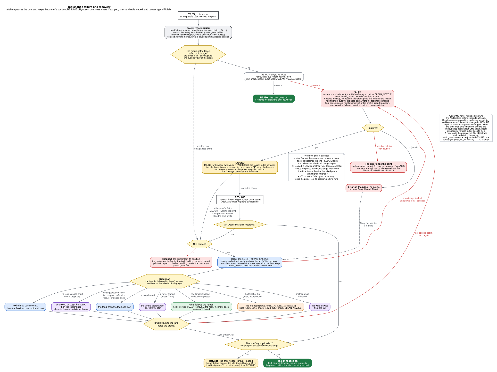

# How the macros run

Every filament move OpenAMS makes at your printer is a chain of macros from `oams_macros.cfg`. This page shows that chain in the order it runs. First comes a state machine, then the exact commands, then which value moves what, and what your printer has to provide. The chain comes from a traced run of the shipped macros.


**How to read it.**

- **Where it starts:** a white box says who starts the sequence: the slicer's `T<n>`, or the panel's **Load** or **Unload**.
- **Grey frames** are macros. The boxes inside one run from top to bottom, and when a macro ends it hands over to the next frame.
- **Colours** say what moves: blue the AMS, orange the extruder, purple the toolhead.
- **Green boxes** are your own macros. Dashed ones are optional.
- **Yellow hexagons** are checks. A failed check goes to a red **fail**, which stops the sequence and goes to **When a step fails**: `OAMSM_TOOLCHANGE` catches it and, in a print, runs `PAUSE`. After you fix the cause, `RESUME` resets the AMS, works out where the lane stopped and re-enters the sequence at a purple letter: **A** runs `_TX` again (the feed, the whole swap, a rewind of that bay first, or an unload through the cutter first), **B** runs only the toolhead part, **C** runs the unload again, **D** runs only what follows a reload that had already passed the outlet check. A printer that lost its position is refused before any of it, and the print goes on only with its group loaded. From there the sequence runs on as drawn, to **Done** or to another pause. [When something fails](#when-something-fails) has the detail.
- **Red words** (home, heat, cut, retract, feed) are the steps the panel and the screen show while it runs.

## Who starts what

| What starts it | What runs | What it does |
|---|---|---|
| `T0`, `T1`, ... (one per group), from the slicer at the start of the print and at each colour change | `OAMSM_TOOLCHANGE GROUP=T<n>`, then `_TX` | A toolchange: unloads the filament in the toolhead, if there is one, and loads the group's next spool |
| The panel's **Load** (`OPENAMS_LOAD GROUP=<group> SLOT=<slot>`) | `OAMSM_TOOLCHANGE GROUP=<group> SLOT=<slot>`, then `_TX` | The same toolchange, for the spool you picked. It checks that spool before anything moves, and a failure stops with an error instead of pausing |
| The panel's **Unload** (`OPENAMS_UNLOAD`) | `OAMSM_TOOLCHANGE UNLOAD=1`, then `SAFE_UNLOAD_FILAMENT STRICT=1` | The unload half of a toolchange: cut, retract, rewind |
| `OAMSM_LOAD_TO_TOOLHEAD GROUP=<group>` | the AMS load, then `_OAMS_TOOLHEAD_LOAD` | A load without the cutter, for the first load and for tests |
| `OAMSM_UNLOAD_FROM_TOOLHEAD` | `_OAMS_TOOLHEAD_EJECT`, then the AMS rewind | An unload without the cutter |
| A spool runs out during a print | no macro | OpenAMS feeds a spare bay of the same group, or runs `PAUSE` when there is none |
| **RESUME**, after a failed toolchange paused the print | `OAMSM_RETRY` logic, then Klipper's resume | Finishes the toolchange from where it stopped, then the print goes on (see [When something fails](#when-something-fails)) |

`OAMSM_LOAD_FILAMENT` and `OAMSM_UNLOAD_FILAMENT` move the AMS alone. The first feeds a bay's filament to the extruder gears; the second rewinds it to its bay. The macros above use them, and neither one moves the extruder.

## A toolchange, command by command

`T1` while `T0` is loaded, with the shipped settings. Each line is a command, indented under the macro that issues it, and the bracketed words are the steps the displays show.

```text
T1
OAMSM_TOOLCHANGE GROUP=T1                 runs the chain below; catches any failure
  _TX GROUP=T1
    _OAMS_PLAN KIND=swap                  works out the temperature, announces the plan
    G28                                   only when the printer isn't homed       [home]
    SAVE_GCODE_STATE NAME=oams_toolchange
                                          remembers the toolhead's place in the print
    SAFE_UNLOAD_FILAMENT STAGED=1
      _OAMS_HEAT
        _OAMS_HOOK_BEFORE_HEAT            yours, if you wrote one
        SET_HEATER_TEMPERATURE            heats and waits, only if the nozzle
                                          is colder                               [heat]
      SAVE_GCODE_STATE NAME=oams_unload
      OAMSM_FOLLOWER ENABLE=1 DIRECTION=0
                                          the AMS follows the extruder backwards
      G1 E-<retract_length>               a short retract                         [cut]
      CUT_FILAMENT                        to pre_cut, cut and post_cut
        OAMS_CUT                          yours, if you wrote one: instead of those moves
      _OAMS_HOOK_AFTER_CUT                yours, if you wrote one
      G1 E-<extrusion_unload_length>      pulls the cut end out of the extruder gears
      _UNLOAD_FS_OUT                      check: the filament has left the extruder
      _OAMS_FINISH_UNLOAD
        G1 E-<extrusion_unload_additional_length>
        OAMSM_UNLOAD_FILAMENT             the AMS rewinds T0's filament to its bay [retract]
        _OAMS_CONFIRM_UNLOADED            check: the AMS reports nothing loaded
    _OAMS_CONTINUE_AFTER_UNLOAD
      _OAMS_HOOK_AFTER_RETRACT            yours, if you wrote one
      OAMSM_LOAD_FILAMENT GROUP=T1        the AMS feeds T1's next spool to the
                                          extruder gears, then follows the extruder [feed]
      _OAMS_CONTINUE_AFTER_LOAD           check: T1 is loaded
        _LOAD_FS_IN                       check: filament at the extruder inlet
        _OAMS_CONTINUE_AFTER_INLET
          _OAMS_RELOAD                    G1 E<extrusion_reload_length + retract_length
                                                + hotend_meltzone_compensation>
          _LOAD_FS_OUT                    check: filament past the extruder
          _OAMS_FINISH_TOOLCHANGE
            CLEAN_NOZZLE                  your macro: wipe or purge
            _OAMS_HOOK_AFTER_FEED         yours, if you wrote one
            _OAMS_RESTORE                 heater back where it was, on an idle printer
            RESTORE_GCODE_STATE NAME=oams_toolchange MOVE=1
                                          back to the print
```

Before every step and every hook, `OAMSM_CHECK_STOP` runs: that is how the panel's Stop button ends a sequence. Klipper renders a whole macro before it runs any of it, so each decision sits in its own small macro (`_OAMS_CONTINUE_AFTER_...`) that sees the result of the step before it.

### What changes the sequence

- **An empty toolhead** (the first `T<n>` of a print): `_TX` heats right after homing and goes straight to `_OAMS_CONTINUE_AFTER_UNLOAD`, with no unload and no `_OAMS_HOOK_AFTER_RETRACT`. The plan is heat, feed.
- **The group is already loaded**, or the current object is excluded: nothing moves. In the first case the console says `Toolhead already loaded with T1`.
- **The panel's Load** checks the slot first (`OAMSM_VALIDATE_LOAD`), then loads exactly that slot. A failed check stops with an error and does not pause.
- **The panel's Unload** runs `SAFE_UNLOAD_FILAMENT STRICT=1` on its own, with its own plan (heat, cut, retract), and ends after `_OAMS_CONFIRM_UNLOADED` by putting the heater back.
- **`clean_after_reload: False`** runs `CLEAN_NOZZLE` before `_OAMS_RELOAD` instead of after it.
- **With gco-routines** and `oams_macros_ordered.cfg`, `OAMSM_LOAD_FILAMENT` runs in the background and `WAIT` joins it before the reload; with `clean_after_reload: False`, `CLEAN_NOZZLE` runs during the feed. `OAMSM_TOOLCHANGE` runs the chain in a gco-routines *handled region*, so a failure, the background load's included, pauses the print as described below instead of ending it (gco-routines from 2026-11-08; [its states](https://github.com/OpenAMSOrg/gco-routines/blob/main/docs/guide/language.md#when-a-command-fails)).
- **Without the toolhead sensors** (`fs_extruder_in` and `fs_extruder_out` False, the default), the three sensor checks pass without looking.

## Which value moves what

All of these are in `[gcode_macro _oams_macro_variables]`, at the top of `oams.cfg`, except `ptfe_length`.

| Step | What moves | The value |
|---|---|---|
| Before the cut | the extruder retracts | `retract_length`, at `unload_speed` |
| The cut | the toolhead goes to the cutter and back | `pre_cut_x`/`pre_cut_y`, `cut_x`/`cut_y`, `post_cut_x`/`post_cut_y`, at `pre_cut_speed` and `cut_speed` |
| After the cut | the extruder pulls the cut end out of its gears | `extrusion_unload_length`, at `unload_speed` |
| Before the rewind | the extruder retracts more | `extrusion_unload_additional_length`, at `additional_unload_speed` |
| The rewind | the AMS pulls the filament back to its bay | (the AMS) |
| The feed | the AMS feeds the new filament to the extruder gears | the bay's `ptfe_length`, in its unit's `[oams]` section |
| The reload | the extruder pushes it from the gears into the melt zone | `extrusion_reload_length` + `retract_length` + `hotend_meltzone_compensation`, at `reload_speed` (with `reload_fast_speed` set, all but the last `reload_slow_length` mm at that speed) |

Starting values for your toolhead: `python3 ~/openams/tools/toolhead_defaults.py list`, then `show` with your entry's name.

## When something fails



**During a print, a failed toolchange pauses the print; it never ends it.** Every toolchange and unload runs inside `OAMSM_TOOLCHANGE`, which catches any error in the chain: a failed check, the AMS refusing or failing, a hook or `CLEAN_NOZZLE` error, homing, a cold extrusion, the Stop button. It has to be a Python command: Klipper macros cannot catch an error, and an error that reaches an SD print makes Klipper run `on_error_gcode` (Mainsail: `CANCEL_PRINT`). With gco-routines, `OAMSM_TOOLCHANGE` runs the chain, and then its own recovery, in gco-routines' *handled regions*; without them gco-routines would fault the print's run at the failing line, whatever OpenAMS did next. An older gco-routines without regions still ends the print on a failure, and Klipper's log says so. On a failure `OAMSM_TOOLCHANGE`:

1. records the fault on the lane: what was being loaded or unloaded, the step that was running, the reason, and whether the AMS had already fed the filament to the gears;
2. puts the toolhead back where the toolchange started (not when the toolchange had to home first: the position before homing means nothing, so the toolhead stays where it failed);
3. stops the AMS follower once it is safe (never under a print that is still printing);
4. in a print, runs `PAUSE`, raises the idle timeout to `pause_idle_timeout`, and writes the reason to the console; from the panel, or outside a print, raises the error instead. If `PAUSE` itself fails, OpenAMS pauses the print directly. If something inside the toolchange had already paused the print, the toolhead is not moved back. If nothing can pause the print (no `[pause_resume]`, or a `PAUSE` macro that does not pause), the console says `could not pause the print`, and the error stands and ends the print: printing on without the filament it asked for would ruin it. OpenAMS warns at startup when `[pause_resume]` is missing.

**RESUME finishes the toolchange.** OpenAMS wraps Klipper's own resume (the `RESUME_BASE` that Mainsail's and Fluidd's `RESUME` call), so RESUME on any screen runs it. A `RESUME` macro can stop before it reaches Klipper's resume: Mainsail's and Fluidd's do when `runout_sensor` is set and that sensor sees no filament. The retry then never runs. Run `OAMSM_RETRY` (or press the panel's **Retry**), then `RESUME`; the pause message says so. If OpenAMS cannot find Klipper's resume command at all, it warns at startup, the print still pauses, and the message tells you to run `OAMSM_RETRY`, then `RESUME`. With a fault recorded, `RESUME` first clears the AMS's latched faults and re-reads the lanes, then runs only what is left:

| What it finds | What it runs |
|---|---|
| the target group loaded, and the AMS had fed it | the toolhead part (`_OAMS_RESUME_TOOLHEAD`): heat, re-arm the follower, inlet check, reload, outlet check, `CLEAN_NOZZLE` |
| the target group loaded, fed, and the reload had finished and passed the outlet check | only what follows the reload: `CLEAN_NOZZLE`, the after-feed hook, the move back. The reload is not pushed a second time |
| the target loaded, but the toolchange stopped in its feed: the target bay is out past its hub, but never reached the gears | a rewind of that bay (`OAMSM_UNLOAD_FILAMENT`), then the toolchange |
| the target loaded, but the toolchange stopped before its feed (it was cut there, say), or the lane changed during the pause | an unload through the cutter (`SAFE_UNLOAD_FILAMENT`), then the toolchange: where that filament ends is not known, and `_TX` alone would take it for loaded |
| it failed before its plan started (while homing, say) | the toolchange again, from the start |
| another group loaded, or another bay of the group than the one a targeted load asked for | the whole swap, from the cut |
| nothing loaded | the feed and the toolhead part |

With gco-routines, the retry runs inside RESUME, where gco-routines starts no routines: OpenAMS runs `_TX` there in a `legacy_in_recovery()` region and it takes its serial path (feed, then the toolhead part, without the overlap). That needs gco-routines with `legacy_in_recovery()` (2026-11-08, evening); an older one refuses the retry with `Recovery macros cannot start managed routines`, and the print stays paused.

The retry counts only when the lane then holds the group (for a Load from the panel, the bay) it was for; otherwise it fails like any other step, and the print stays paused. It loads the group even if you excluded the current object during the pause: a `T<n>` of an excluded object is skipped, but the one it retries was not.

A retry from the panel or the console while the print is paused belongs to the print too: if it fails, `RESUME` still retries it, and the fault goes when the print ends. A `T<n>` to the group that failed is such a retry: it runs the same diagnosis, never a plain toolchange that would find the group "loaded" and do nothing. The print's own `T<n>` to the group of a Load that failed from the panel (before the print, say) is one too, and it takes that toolchange over as the print's: any bay of the group, not the bay the panel asked for. If its reset refuses (a fault stays latched), the print pauses, as for any other failure.

**The print's failed toolchange stays until it is finished.** Anything else you do while the print is paused is your own action: an Unload, a Load of another spool, a `T<n>` to another group. It runs, and if it fails it raises its own error, but it never replaces the print's failed toolchange, and `RESUME` still finishes that one. It does change where the lane is, and OpenAMS keeps track: a Load of the print's group that finishes (any bay) finishes the print's toolchange too, so `RESUME` moves nothing; any other action that started leaves the print's toolchange with that action's step, fed only if it was a Load of the print's group that fed it. So `RESUME` never rewinds a filament you loaded to the nozzle, nor reloads one an Unload cut.

**RESUME checks what is loaded.** Before the print goes on, the lane must hold the group of the print's last finished toolchange. If it holds nothing or another group, `RESUME` stops with `the print needs <group> loaded on lane <lane>`, and the print stays paused, with the idle timeout at `pause_idle_timeout` again (a `RESUME` macro such as Mainsail's puts its own value back before it calls Klipper's resume). Load that group, then press `RESUME`. If Klipper's own resume refuses after a successful retry (a move back out of range, say), the idle timeout goes back to `pause_idle_timeout` too.

**Nothing homes a paused print.** If the motors were turned off while the print waited (the idle timeout does that), the printer has lost its position. `RESUME` and `OAMSM_RETRY` then refuse with `the printer lost its position`, move nothing, and keep the print paused; the print cannot be resumed safely. A toolchange (`T<n>`), the panel's Load or Unload refuse the same way while a print is paused (`OpenAMS will not run ... while the print is paused: the printer lost its position`), since each would home with the print on the bed; cancel the print first. To keep that from happening, OpenAMS raises the idle timeout to `pause_idle_timeout` (48 hours by default) when it pauses a print for a failed toolchange, and puts it back when the print resumes, is cancelled or ends. The heaters and the motors stay on until it expires.

**Keep `T<n>` out of the middle of a macro.** Klipper runs the rest of a macro after a `PAUSE`. Call `T<n>` as a line of the print file, or as the last command of a macro. If a macro does run another `T<n>` while the print is paused for a failed one, OpenAMS moves nothing: that group becomes the one `RESUME` loads, from where the failed toolchange stopped (a filament cut and still loaded is unloaded first).

When that works, Klipper's resume returns to the print. When it fails, the print stays paused, the console says why, and `RESUME` can be pressed again. OpenAMS never retries on its own: the AMS retries before it reports a failure.

**From the panel**, a failed Load or Unload raises its error; there is no print to pause. `OAMSM_RETRY` is refused while a print is printing; it runs while the print is paused, or with no print. The lane's `toolchange_fault` in the status lets the panel offer **Retry** (`OAMSM_RETRY`, the same diagnosis), **Unload** (`OPENAMS_UNLOAD`) and **Abandon** (`OAMSM_ABANDON`: forget it, leave the filament where it stopped, then Reset).

**Reset** (`OAMSM_CLEAR_ERRORS`, **Clear errors** in the panels and the LCD menu: the one way to clear) sends each unit with a latched fault its `OAMS_CLEAR_FAULT`, and is done once the latches have stayed gone for 10 s (a fault can look cleared for a moment, then latch again), or after the unit's 15 to 20 s recovery window otherwise. It names any fault that stays latched, which then says to power the AMS off and on, and re-reads the lanes. It never moves anything. It keeps an unfinished toolchange, so a later `RESUME` still finishes it; a print's fault is dropped when that print ends. A Load or Unload from the panel that failed before it started (a bay outside the group, say) moved nothing, so Reset clears it: `had not started; cleared`.

A failed sequence leaves the heater on, so a retry starts hot. A move already queued when something fails (a `G1`, the cutter, homing) finishes first. The messages are in [troubleshooting](troubleshooting.md).

## Without the cutter

These two commands are for the first load and for tests. A print never runs them.

```text
OAMSM_LOAD_TO_TOOLHEAD GROUP=T0
  OAMSM_LOAD_FILAMENT       the AMS feeds to the extruder gears, then follows the extruder
  _OAMS_TOOLHEAD_LOAD       heats when the spool's temperature is known and the nozzle is colder
    _OAMS_RELOAD            the same move as in a toolchange

OAMSM_UNLOAD_FROM_TOOLHEAD
  OAMSM_FOLLOWER            the AMS follows the extruder backwards
  _OAMS_TOOLHEAD_EJECT      heats if colder, 10 mm forward to soften the tip,
                            then 100 mm back in 25 mm moves
  OAMSM_UNLOAD_FILAMENT     the AMS rewinds the filament to its bay
```

Without a cut, the whole filament comes back out through the extruder. `_OAMS_TOOLHEAD_LOAD` and `_OAMS_TOOLHEAD_EJECT` are the defaults of `toolhead_load_macro` and `toolhead_unload_macro` in `[oams_manager]`, and both ship in `oams_macros.cfg`.

## When a spool runs out

No macro runs. OpenAMS watches how far the extruder has pulled against `ptfe_length`. When the spool ends, it stops the follower, lets the rest of the filament run out of the buffer, and feeds a spare bay of the same group while the print goes on. With no spare bay, or with `auto_reload_on_runout` off, it runs `PAUSE`. More in [groups and runout](using.md#groups-and-runout).

## What your printer provides

| Macro | Needed | What for |
|---|---|---|
| `CLEAN_NOZZLE` | yes | Every toolchange calls it once the new filament is down in the nozzle, to wipe or purge. Nothing ships it. Without a nozzle cleaner, an empty one will do (below) |
| `PAUSE`, `RESUME` and `[pause_resume]` | yes | A failed toolchange, and a runout with no spare bay, pause the print, and `RESUME` finishes the toolchange. Mainsail's `mainsail.cfg` has them. Without `[pause_resume]` OpenAMS warns at startup, and a failed toolchange ends the print |
| `OAMS_CUT` | no | Replaces the cutter moves of `CUT_FILAMENT` |
| `_OAMS_HOOK_BEFORE_HEAT`, `_OAMS_HOOK_AFTER_CUT`, `_OAMS_HOOK_AFTER_RETRACT`, `_OAMS_HOOK_AFTER_FEED` | no | Your own moves at those points: a park, a brush, a purge |
| `LOAD_FILAMENT`, `UNLOAD_FILAMENT` | no | OpenAMS doesn't call them |

An empty `CLEAN_NOZZLE`, for a printer without a nozzle cleaner:

```ini
[gcode_macro CLEAN_NOZZLE]
gcode:
  RESPOND MSG="CLEAN_NOZZLE: no nozzle cleaner configured"
```

Don't edit `oams_macros.cfg`: it is a link to your OpenAMS checkout, and an update replaces it. Put your own macros in your own file, such as `oams.cfg` or `printer.cfg`. [Customizing the toolchange](configure.md#customizing-the-toolchange) shows how to write `OAMS_CUT` and the hooks.

The drawing is made from [`docs/images/macro-sequence.dot`](../images/macro-sequence.dot) with Graphviz (`dot -Tsvg`).
