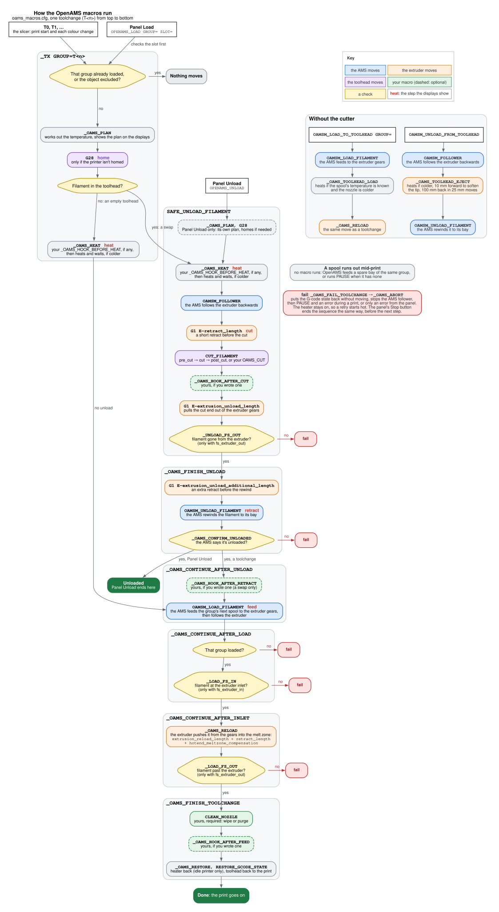

# How the macros run

Every filament move OpenAMS makes at your printer is a chain of macros from `oams_macros.cfg`. This page shows that chain in the order it runs. First comes a state machine, then the exact commands, then which value moves what, and what your printer has to provide. The chain comes from a traced run of the shipped macros.



**How to read it.**

- **Where it starts:** a white box says who starts the sequence: the slicer's `T<n>`, or the panel's **Load** or **Unload**.
- **Grey frames** are macros. The boxes inside one run from top to bottom, and when a macro ends it hands over to the next frame.
- **Colours** say what moves: blue the AMS, orange the extruder, purple the toolhead.
- **Green boxes** are your own macros. Dashed ones are optional.
- **Yellow hexagons** are checks. A failed check goes to a red **fail**, which stops the sequence.
- **Red words** (home, heat, cut, retract, feed) are the steps the panel and the screen show while it runs.

## Who starts what

| What starts it | What runs | What it does |
|---|---|---|
| `T0`, `T1`, ... (one per group), from the slicer at the start of the print and at each colour change | `_TX GROUP=T<n>` | A toolchange: unloads the filament in the toolhead, if there is one, and loads the group's next spool |
| The panel's **Load** (`OPENAMS_LOAD GROUP=<group> SLOT=<slot>`) | `_TX GROUP=<group> SLOT=<slot>` | The same toolchange, for the spool you picked. It checks that spool before anything moves, and a failure stops with an error instead of pausing |
| The panel's **Unload** (`OPENAMS_UNLOAD`) | `SAFE_UNLOAD_FILAMENT STRICT=1` | The unload half of a toolchange: cut, retract, rewind |
| `OAMSM_LOAD_TO_TOOLHEAD GROUP=<group>` | the AMS load, then `_OAMS_TOOLHEAD_LOAD` | A load without the cutter, for the first load and for tests |
| `OAMSM_UNLOAD_FROM_TOOLHEAD` | `_OAMS_TOOLHEAD_EJECT`, then the AMS rewind | An unload without the cutter |
| A spool runs out during a print | no macro | OpenAMS feeds a spare bay of the same group, or runs `PAUSE` when there is none |

`OAMSM_LOAD_FILAMENT` and `OAMSM_UNLOAD_FILAMENT` move the AMS alone. The first feeds a bay's filament to the extruder gears; the second rewinds it to its bay. The macros above use them, and neither one moves the extruder.

## A toolchange, command by command

`T1` while `T0` is loaded, with the shipped settings. Each line is a command, indented under the macro that issues it, and the bracketed words are the steps the displays show.

```text
T1
_TX GROUP=T1
  _OAMS_PLAN KIND=swap                    works out the temperature, announces the plan
  G28                                     only when the printer isn't homed       [home]
  SAVE_GCODE_STATE NAME=oams_toolchange   remembers the toolhead's place in the print
  SAFE_UNLOAD_FILAMENT STAGED=1
    _OAMS_HEAT
      _OAMS_HOOK_BEFORE_HEAT              yours, if you wrote one
      SET_HEATER_TEMPERATURE              heats and waits, only if the nozzle
                                          is colder                               [heat]
    SAVE_GCODE_STATE NAME=oams_unload
    OAMSM_FOLLOWER ENABLE=1 DIRECTION=0   the AMS follows the extruder backwards
    G1 E-<retract_length>                 a short retract                         [cut]
    CUT_FILAMENT                          to pre_cut, cut and post_cut
      OAMS_CUT                            yours, if you wrote one: instead of those moves
    _OAMS_HOOK_AFTER_CUT                  yours, if you wrote one
    G1 E-<extrusion_unload_length>        pulls the cut end out of the extruder gears
    _UNLOAD_FS_OUT                        check: the filament has left the extruder
    _OAMS_FINISH_UNLOAD
      G1 E-<extrusion_unload_additional_length>
      OAMSM_UNLOAD_FILAMENT               the AMS rewinds T0's filament to its bay [retract]
      _OAMS_CONFIRM_UNLOADED              check: the AMS reports nothing loaded
  _OAMS_CONTINUE_AFTER_UNLOAD
    _OAMS_HOOK_AFTER_RETRACT              yours, if you wrote one
    OAMSM_LOAD_FILAMENT GROUP=T1          the AMS feeds T1's next spool to the
                                          extruder gears, then follows the extruder [feed]
    _OAMS_CONTINUE_AFTER_LOAD             check: T1 is loaded
      _LOAD_FS_IN                         check: filament at the extruder inlet
      _OAMS_CONTINUE_AFTER_INLET
        _OAMS_RELOAD                      G1 E<extrusion_reload_length + retract_length
                                                + hotend_meltzone_compensation>
        _LOAD_FS_OUT                      check: filament past the extruder
        _OAMS_FINISH_TOOLCHANGE
          CLEAN_NOZZLE                    your macro: wipe or purge
          _OAMS_HOOK_AFTER_FEED           yours, if you wrote one
          _OAMS_RESTORE                   heater back where it was, on an idle printer
          RESTORE_GCODE_STATE NAME=oams_toolchange MOVE=1   back to the print
```

Before every step and every hook, `OAMSM_CHECK_STOP` runs: that is how the panel's Stop button ends a sequence. Klipper renders a whole macro before it runs any of it, so each decision sits in its own small macro (`_OAMS_CONTINUE_AFTER_...`) that sees the result of the step before it.

### What changes the sequence

- **An empty toolhead** (the first `T<n>` of a print): `_TX` heats right after homing and goes straight to `_OAMS_CONTINUE_AFTER_UNLOAD`, with no unload and no `_OAMS_HOOK_AFTER_RETRACT`. The plan is heat, feed.
- **The group is already loaded**, or the current object is excluded: nothing moves. In the first case the console says `Toolhead already loaded with T1`.
- **The panel's Load** checks the slot first (`OAMSM_VALIDATE_LOAD`), then loads exactly that slot. A failed check stops with an error and does not pause.
- **The panel's Unload** runs `SAFE_UNLOAD_FILAMENT STRICT=1` on its own, with its own plan (heat, cut, retract), and ends after `_OAMS_CONFIRM_UNLOADED` by putting the heater back.
- **`clean_after_reload: False`** runs `CLEAN_NOZZLE` before `_OAMS_RELOAD` instead of after it.
- **With gco-routines** and `oams_macros_ordered.cfg`, `OAMSM_LOAD_FILAMENT` runs in the background and `WAIT` joins it before the reload; with `clean_after_reload: False`, `CLEAN_NOZZLE` runs during the feed.
- **Without the toolhead sensors** (`fs_extruder_in` and `fs_extruder_out` False, the default), the three sensor checks pass without looking.

## Which value moves what

All of these are in `[gcode_macro _oams_macro_variables]`, at the top of `oams.cfg`, except `ptfe_length`.

| Step | What moves | The value |
|---|---|---|
| Before the cut | the extruder retracts | `retract_length`, at `unload_speed` |
| The cut | the toolhead goes to the cutter and back | `pre_cut_x`/`pre_cut_y`, `cut_x`/`cut_y`, `post_cut_x`/`post_cut_y`, at `pre_cut_speed` and `cut_speed` |
| After the cut | the extruder pulls the cut end out of its gears | `extrusion_unload_length`, at `unload_speed` |
| Before the rewind | the extruder retracts more | `extrusion_unload_additional_length`, at `additional_unload_speed` |
| The rewind | the AMS pulls the filament back to its bay | (the AMS) |
| The feed | the AMS feeds the new filament to the extruder gears | the bay's `ptfe_length`, in its unit's `[oams]` section |
| The reload | the extruder pushes it from the gears into the melt zone | `extrusion_reload_length` + `retract_length` + `hotend_meltzone_compensation`, at `reload_speed` (with `reload_fast_speed` set, all but the last `reload_slow_length` mm at that speed) |

Starting values for your toolhead: `python3 ~/openams/tools/toolhead_defaults.py list`, then `show` with your entry's name.

## When something fails

A check that fails stops the sequence through `_OAMS_FAIL_TOOLCHANGE` and `_OAMS_ABORT`. These put the G-code state back without moving and stop the AMS follower; during a print they run `PAUSE`, and in every case they raise the error. The sensor checks record the failure, and the helper after them stops. A failing OpenAMS command (an AMS load or unload, a latched unit fault, the Stop button) raises its error at once, without `PAUSE`.

**During a print, a failed toolchange ends the print.** Klipper answers an error in an SD print with `on_error_gcode`, which Mainsail sets to `CANCEL_PRINT`, and stops reading the file. To try again, fix the cause, run `OAMS_CLEAR_FAULT OAMS=<n>` if the AMS latched a fault, then `OAMSM_CLEAR_ERRORS`, and run the toolchange again. A retry starts from the beginning and plans from what the AMS reports: when the failure came after the feed, the AMS counts the new group as loaded and `T<n>` does nothing, so unload first (`OAMSM_UNLOAD_FILAMENT` when the filament never reached the extruder, `OPENAMS_UNLOAD` otherwise). A change that makes a failure pause the print, with `RESUME` continuing where it stopped, is in progress.

From the panel (`OPENAMS_LOAD`, `OPENAMS_UNLOAD`) a failure raises the error and does not pause: there is no print to protect.

A failed sequence leaves the heater on, so a retry starts hot. The Stop button ends the sequence the same way, before the next step; a move already queued (a `G1`, the cutter, homing) finishes first. The messages are in [troubleshooting](troubleshooting.md).

## Without the cutter

These two commands are for the first load and for tests. A print never runs them.

```text
OAMSM_LOAD_TO_TOOLHEAD GROUP=T0
  OAMSM_LOAD_FILAMENT       the AMS feeds to the extruder gears, then follows the extruder
  _OAMS_TOOLHEAD_LOAD       heats when the spool's temperature is known and the nozzle is colder
    _OAMS_RELOAD            the same move as in a toolchange

OAMSM_UNLOAD_FROM_TOOLHEAD
  OAMSM_FOLLOWER            the AMS follows the extruder backwards
  _OAMS_TOOLHEAD_EJECT      heats if colder, 10 mm forward to soften the tip,
                            then 100 mm back in 25 mm moves
  OAMSM_UNLOAD_FILAMENT     the AMS rewinds the filament to its bay
```

Without a cut, the whole filament comes back out through the extruder. `_OAMS_TOOLHEAD_LOAD` and `_OAMS_TOOLHEAD_EJECT` are the defaults of `toolhead_load_macro` and `toolhead_unload_macro` in `[oams_manager]`, and both ship in `oams_macros.cfg`.

## When a spool runs out

No macro runs. OpenAMS watches how far the extruder has pulled against `ptfe_length`. When the spool ends, it stops the follower, lets the rest of the filament run out of the buffer, and feeds a spare bay of the same group while the print goes on. With no spare bay, or with `auto_reload_on_runout` off, it runs `PAUSE`. More in [groups and runout](using.md#groups-and-runout).

## What your printer provides

| Macro | Needed | What for |
|---|---|---|
| `CLEAN_NOZZLE` | yes | Every toolchange calls it once the new filament is down in the nozzle, to wipe or purge. Nothing ships it. Without a nozzle cleaner, an empty one will do (below) |
| `PAUSE`, `RESUME` and `[pause_resume]` | yes | A failed toolchange, and a runout with no spare bay, pause the print. Mainsail's `mainsail.cfg` has them |
| `OAMS_CUT` | no | Replaces the cutter moves of `CUT_FILAMENT` |
| `_OAMS_HOOK_BEFORE_HEAT`, `_OAMS_HOOK_AFTER_CUT`, `_OAMS_HOOK_AFTER_RETRACT`, `_OAMS_HOOK_AFTER_FEED` | no | Your own moves at those points: a park, a brush, a purge |
| `LOAD_FILAMENT`, `UNLOAD_FILAMENT` | no | OpenAMS doesn't call them |

An empty `CLEAN_NOZZLE`, for a printer without a nozzle cleaner:

```ini
[gcode_macro CLEAN_NOZZLE]
gcode:
  RESPOND MSG="CLEAN_NOZZLE: no nozzle cleaner configured"
```

Don't edit `oams_macros.cfg`: it is a link to your OpenAMS checkout, and an update replaces it. Put your own macros in your own file, such as `oams.cfg` or `printer.cfg`. [Customizing the toolchange](configure.md#customizing-the-toolchange) shows how to write `OAMS_CUT` and the hooks.

The drawing is made from [`docs/images/macro-sequence.dot`](../images/macro-sequence.dot) with Graphviz (`dot -Tsvg`).
