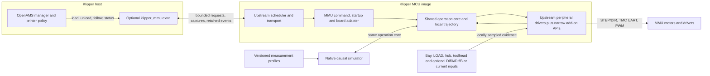

# Klipper-MMU software architecture

Klipper-MMU is an optional add-on to upstream Klipper. The host selects an MMU
operation and supervises printer cooperation; the MCU generates motor steps,
ramps, PWM and immediate protection without a host round trip for each update.
The same portable control core is linked into native tests and the physical
simulator.

The host owns tool mapping, printer pause and handoff, spool policy, persistence,
and slower diagnostics. Firmware owns admission, actuator outputs, locally
retargetable motion, sensor freshness, watchdogs and safe-off. A firmware event
is retained until the host can reconcile it. A fault diagnostic revokes motion
and requests a printer pause without ACKing. An explicit retained-fault ACK
requires a fresh matching capture and queue head, strict OpenAMS reducer
acceptance, and a confirmed reply; active or uncertain followers still block
that path. ACK does not clear the firmware fault or restore motor permission.
Emergency stop makes position uncertain, so a separate physical reconciliation
procedure is needed before fault clearance can safely be exposed.
The [OpenAMS fault hook](../integration/openams/README.md) is part of
OpenAMS itself (`src/oams_runtime.py` in this repository); the Klipper
installer does not change OpenAMS.

Configuration follows Klipper's normal `make menuconfig`: select the upstream
MCU target first, enable the add-on, then choose a device profile and edit
individual MCU pins, polarity, pulls and optional capabilities. A profile
supplies defaults, not a board lock. BoxTurtle, NightOwl, EMU and Custom have shared profile factories. Other menu
entries are a catalogue until their mechanism and board services are implemented.
H723 has the analog-feedback/powered-rewind binding. F207, F405, F407, F429,
F765, G431, G474, H743, H750, G0B0 and G0B1 additionally have saved-image
passive Custom/NightOwl startup and operation checks. Build and modeled runtime evidence remain
distinct from physical actuation qualification; see the target acceptance map.

The BoxTurtle reference connects OpenAMS DiffA/DiffB to AFC Lite SW1/PC4 and
SW2/PC5 as local analog inputs. Calibration accounts for channels on opposite
sides of nominal 1.65 V. Current sensing, encoder feedback and a LOAD switch
are additive; their absence does not turn configured motor current into a
measurement or invent a sensor transition. The simulator derives switch and
buffer readings from material motion, accepts versioned parameters, and keeps
synthetic data distinct from measurements. Real timing and geometry captures
are still required for hardware qualification.

Selectors are bound to the device profiles: linear, rotary, servo and indexed
selectors build from each device's Kconfig and home before the first selection
([selectors](selectors.md)); they are software candidates, not yet run on real
hardware. A device-local screen and BLDC backend remain deferred. See the
acceptance map and [current status](../IMPLEMENTATION_STATUS.md)
for the implemented and remaining scope.

The parity review disposition now governs the next
shared parity repairs: usable stopped recovery, bounded FPS arrival/calibration,
host transaction consistency, lean timing paths, simpler integration and one
aggregate test command. Native menuconfig and firmware motor ownership remain
requirements. Recommendations in that document are planned until their tests
and commits are recorded; the architecture diagram does not imply completion.
